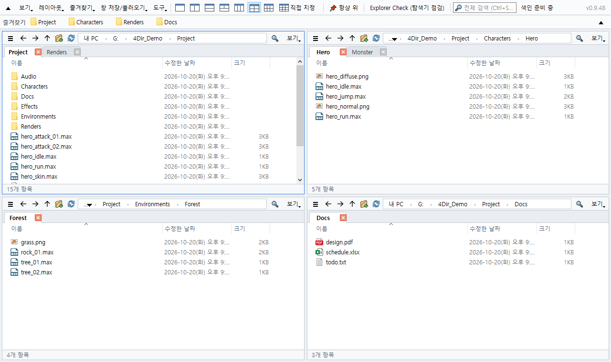

# 4Dir

**윈도우용 여러 칸 분할 + 탭 파일 관리자 — 무료, 설치 없음, PC 를 무겁게 하지 않음.**

[사이트·받기](https://gkstmdahr.github.io/4Dir/ko/) · [배포판](https://github.com/gkstmdahr/4Dir/releases) · [English](README.md)

- **최대 20칸** — 1·2·3·4·6칸 버튼 하나로, 또는 가로 5 × 세로 4 까지. 칸마다 탭.
- **PC 를 무겁게 하지 않음** — 윈도우 셸 화면 없이 폴더를 직접 읽고, 쉴 때는 타이머·폴링 없음. 3ds Max·게임 옆에 켜 둬도 안전.
- **바로 찾는 검색** — 자체 파일 이름 색인, 실시간 갱신, 관리자 권한 필요 없음.
- **SVN 상태** — `.svn` 을 직접 읽어 표시. Git·Perforce 는 윈도우 겹침 아이콘.
- **탐색기와 같은 손맛** — 같은 단축키, 윈도우 우클릭 메뉴, 끌어다 놓기.
- **휴대용** — 설정은 폴더 안에만. 밝게/어둡게, 10개 언어.

## 설치

1. [배포판](https://github.com/gkstmdahr/4Dir/releases)에서 zip 을 받습니다.
2. zip 우클릭 → 속성 → **차단 해제** → 확인.
3. 아무 곳에나 풀고 **4Dir.vbs** 실행.

## 후원

4Dir 는 무료이고 광고가 없습니다. 도움이 됐다면 [사이트](https://gkstmdahr.github.io/4Dir/ko/#donate)에서 후원할 수 있습니다.

## 라이선스

GPL-3.0 — [LICENSE](LICENSE). "4Dir" 이름과 아이콘은 원작 프로젝트 표시이므로, 고쳐서 따로 배포할 때는 다른 이름을 써 주세요.
