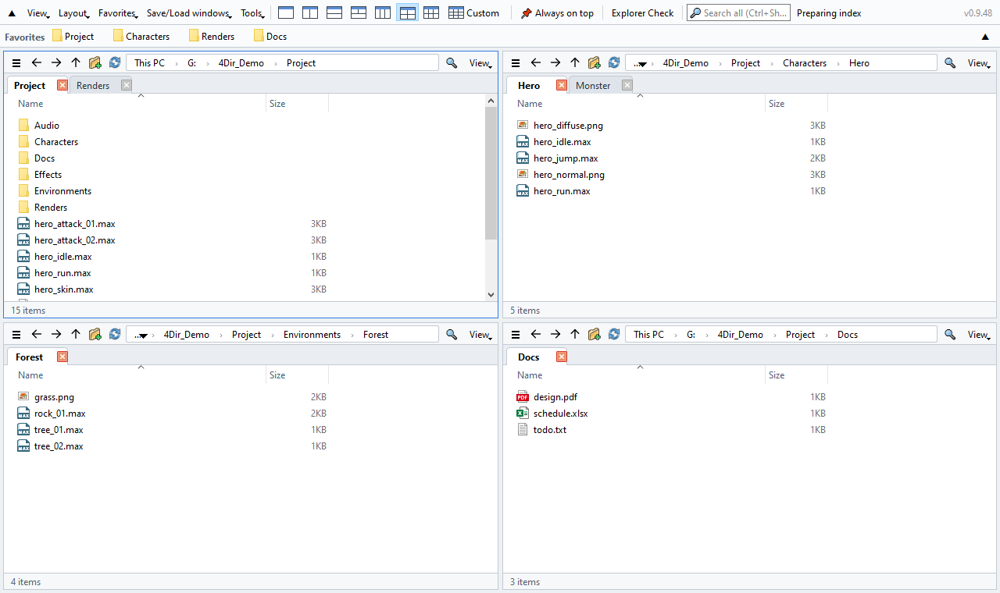

# 4Dir

**Multi-pane tabbed file manager for Windows — free, portable, light on your PC.**

[Website & download](https://4dir.net/) · [Releases](https://github.com/gkstmdahr/4Dir/releases) · [한국어](README.ko.md)

> **Download the release zip from [Releases](https://github.com/gkstmdahr/4Dir/releases/latest)** (`4Dir_v….zip`).
> The green **Code → Download ZIP** button gives source code only — it won't run without Python 3.12+ and PySide6.

- **Up to 20 panes** — 1/2/3/4/6 pane layouts with one click, or any grid up to 5 × 4. Tabs in every pane.
- **Stays out of the way** — reads folders directly (no Windows shell view), no timers or polling when idle. Safe next to 3ds Max, games and other heavy apps.
- **Instant search** — its own file-name index with real-time updates, no admin rights.
- **SVN status** — badges read straight from `.svn`; Git / Perforce through Windows overlays.
- **Feels like Explorer** — same shortcuts, full Windows context menu, drag & drop.
- **Portable** — settings stay in the folder. Light/dark theme, 10 languages.

## Install

1. Download the zip from [Releases](https://github.com/gkstmdahr/4Dir/releases).
2. Right-click the zip → Properties → **Unblock** → OK.
3. Extract anywhere and run **4Dir.vbs**.

The release zip contains the official python.org embeddable Python, PySide6 (Qt, LGPL-3.0) and pywin32 — nothing to install.

## Run from source

Python 3.13 + `pip install PySide6 pywin32`, then run `4Dir.vbs` (uses `pythonw` on PATH) or `pythonw bin/main.py`.
Build a release: `python _build/make_release.py` (needs your own `_build/corp_words.txt`, one forbidden word per line).

## Problems / feedback

In 4Dir: **Tools → Save log for problem report → Send by email**, or email the zip to **support@4dir.net**. GitHub users can also open an [issue](https://github.com/gkstmdahr/4Dir/issues/new/choose).

## Support

4Dir is free and has no ads. If it saves you time, you can support development on the [website](https://4dir.net/#donate).

## License

GPL-3.0 — see [LICENSE](LICENSE). The name "4Dir" and its icon identify the original project; please use a different name for forks.
